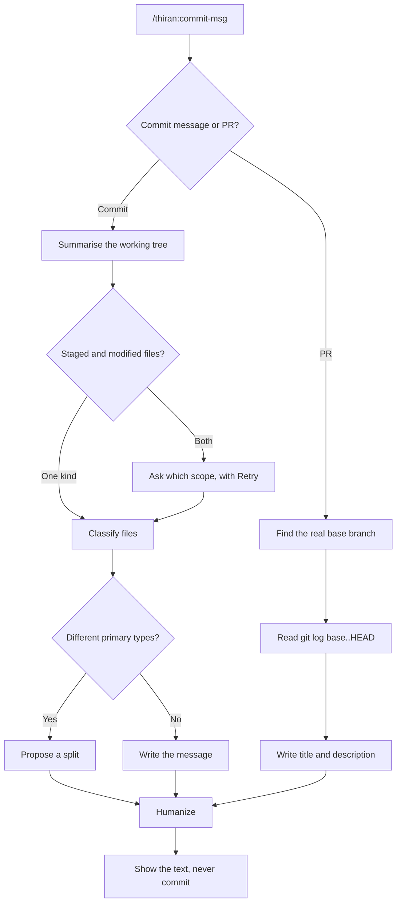

# commit-msg

Writes a Conventional Commits message from your staged or modified changes, or a pull request title and description from the commits on your branch. It reads the real diff, applies a few clear rules, and gives you text to copy. It never runs `git commit` for you.

Part of the `thiran` plugin. Docs: <https://gmbalaa14.github.io/thiran-pattarai-docs/plugins/thiran/commit-msg/>

## Quick start

```
/plugin marketplace add gmbalaa14/thiran-pattarai
/plugin install thiran@pattarai
```

Then, inside a git repository:

```
/thiran:commit-msg
```

It asks whether you want a commit message or a PR description. Saying so up front skips the question: `/thiran:commit-msg commit message`.

## How it works



- **Summarise the working tree:** counts staged, modified and untracked files, and names any file that is only partly staged.
- **Ask which scope:** asked only when there is a real choice. Untracked files are always left out.
- **Classify files:** sorts files into code, docs, tests and generated companions such as lockfiles.
- **Split or write:** one primary type gives one message. Mixed types give a split proposal with the files for each commit.
- **Find the real base branch:** picks the nearest ancestor, so a branch cut from `develop` is compared to `develop`, not `main`.
- **Humanize:** removes machine-written tells such as em dashes and filler summaries before you see the text.

## What you get

| Your changes | Result |
| --- | --- |
| A feature with tests and a README edit | `feat(orders): ...` with the body line `Also adds tests and updates the README.` |
| A bug fix and a new feature | A proposed split into two commits, with the files for each |
| Fixes in two folders | One message: `fix(encryption,utils): ...` |
| One test file and one docs file | `test(...)` with `Also updates the README.`, plus a line on how to switch to `docs` |
| Only a lockfile refresh | `chore(deps): refresh package-lock` |
| Nothing staged, but modified files | A question: describe the modified files, retry after staging, or cancel |
| A branch cut from `develop` | PR text built from `develop..HEAD`, with the base shown first |

## Rules at a glance

- Subjects are `type(scope): lowercase imperative description`, with no trailing period and at most 72 characters.
- Docs, tests and generated files ride along with another type and never trigger a split. Different primary types do.
- Breaking changes get a `!` and a `BREAKING CHANGE:` footer.

The full table is on the docs site: <https://gmbalaa14.github.io/thiran-pattarai-docs/plugins/thiran/commit-msg/#rules-at-a-glance>. It is built from [`rules.json`](rules.json), so there is one copy to keep up to date.

## Requirements

- A git repository.
- `git` and `bash`. On Windows, use Git Bash.

## Files in this folder

| File | Purpose |
| --- | --- |
| `SKILL.md` | The instructions Claude follows |
| `scripts/git-summary.sh` | Read-only script: counts files, classifies them, detects the PR base branch |
| `references/file-classification.md` | Which files count as docs, tests or companions, and how the type is chosen |
| `references/humanizer-rules.md` | The writing rules that keep the text from reading as machine-written |
| `rules.json` | The rules table shown on the docs site |
| `README.md` | This file |

## How to customise

- **Add path patterns:** edit the `classify()` function in `scripts/git-summary.sh` and the table in `references/file-classification.md` so they stay in step. For example, add `*.stories.tsx` to the tests patterns.
- **Change the writing rules:** edit `references/humanizer-rules.md`. Add banned words or phrases there.
- **Change a rule:** edit `references/file-classification.md` (the behaviour) and `rules.json` (the docs-site summary) together.
- **Test a change:** make a throwaway repo, stage a few files, and run `bash scripts/git-summary.sh commit staged` to see the counts.

## Troubleshooting

- **"Working tree is clean":** there is nothing to describe. Make or stage a change first.
- **Untracked file missing from the message:** untracked files are always excluded, because they are often scratch files. Run `git add <file>`, then choose Retry.
- **The PR base looks wrong:** the skill tells you which base it used. Say which branch is correct and it will redo the log against that one.
- **A file is classified wrongly:** see How to customise. The skill also says so when a classification looks off.
- **Script fails on Windows:** run Claude Code from Git Bash, which provides `bash`.

## Changelog

- **1.1.0:** asks what to generate first. Adds the staged versus modified scope question with Retry. Adds file classification, ride-along rules and split proposals. Detects the real PR base branch. Moves the writing rules into `references/humanizer-rules.md`. Subjects now follow the Conventional Commits style: lowercase and no trailing period.
- **1.0.0:** first release. Commit messages and PR descriptions from staged changes.
